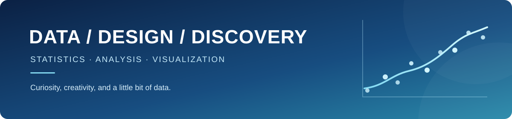

<h1 align="center">Hi, I'm Aspreee 👋</h1>

<strong>Statistics student · Data analysis · Visualization</strong>

  
  
  

## About me

I'm a statistics student interested in using data to understand real-world questions. I'm learning through coursework and small projects, and I enjoy turning numbers into visuals that are easier to understand.

## What I'm learning

- 📊 Statistical analysis and regression
- 💻 Working with data in R and SAS
- 📈 Data visualization with R and ggplot2
- 📝 Sharing analysis with R Markdown

## Beyond the numbers

I also have a background in art, which shapes the way I think about visual design and communicating ideas. I'm interested in data analytics opportunities where I can keep learning and apply my skills to real problems.

---

🌱 **Just getting started:** I'm building my GitHub one project at a time.
